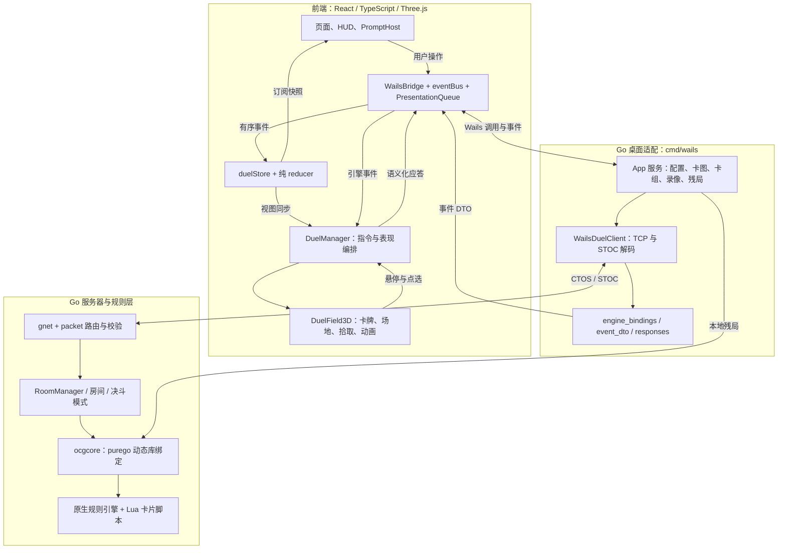
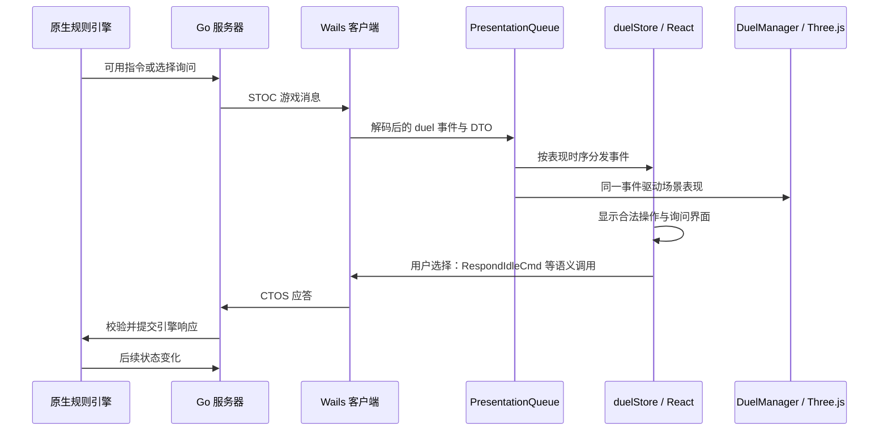
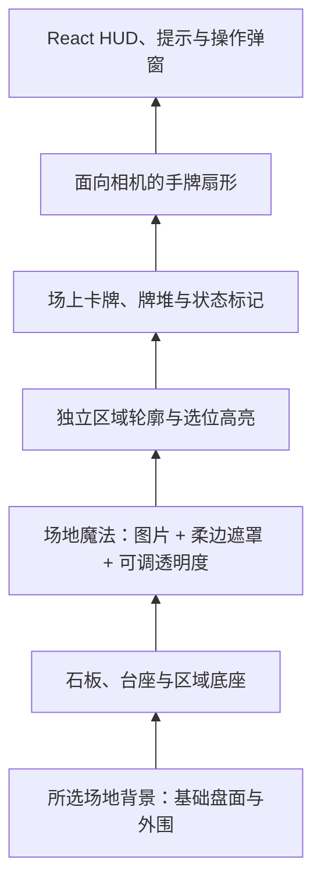

# GoYGOPro

基于 Go、Wails v3、React 和 Three.js 的游戏王对战客户端与服务器。Go 负责网络协议、房间、规则引擎和本地资源，React 展示状态与询问界面，Three.js 绘制卡牌和对局场地。

当前游戏内界面参考 Master Duel 的构图与交互，场景使用项目内生成的石砖、台座和区域几何；并非官方客户端或官方场景资产的复刻。

## 功能与入口

- 主菜单、联机大厅、建房与准备、卡组编辑、单人残局、录像回放。
- 实时决斗事件、阶段切换、场上选位与选卡、连锁询问、墓地等牌堆查看。
- 石质竞技场、独立区域轮廓、实体牌堆与更俯视的对局镜头。
- 我方底部扇形手牌、对方顶部紧凑卡背、悬停放大摆正、多张手牌压缩及视角交换。
- 「环境设置 → 决斗外观」提供内置卡套、场地背景与 PNG / JPG / WebP 图片导入。
- 场地魔法柔边叠加、双方不同环境分半场显示、环境浓度调整与缺图回退。

## 快速开始

### 环境与资源

推荐使用 Windows、Go 1.25 或以上、Node.js 20 或以上，以及支持 WebGL 的浏览器。Windows 桌面运行需要 WebView2；完整构建还取决于 Wails v3 的平台依赖。当前主要在 Windows 上验证。

| 资源 | 用途与位置 |
| --- | --- |
| `cards.cdb`、`script/`、`strings.conf` | 卡片数据、Lua 规则脚本、系统字符串 |
| `ocgcore.dll` / `libocgcore.so` / `libocgcore.dylib` | 与项目绑定 API 匹配的原生规则引擎，放在资源根目录；动态库依赖也需可被系统加载 |
| `deck/`、`single/`、`replay/` | 卡组、残局脚本、运行时录像 |
| `pics/<卡号>.jpg`、`pics/field/<卡号>.png` 或 `.jpg` | 可选的本地卡图、场地魔法图；具体支持路径见 `cmd/wails/app.go` |
| `frontend/textures/` | 内置界面和场地素材，Vite 构建时复制运行时纹理 |

仓库已有部分数据库与平台引擎文件，但不代表所有平台、依赖和卡图都齐备。原生引擎加载逻辑见 `ocgcore/api.go`，参考源码位于 `source/ygopro/`。前端构建成功不等于原生引擎已能运行。

### 浏览器预览

在仓库根目录执行：

```powershell
npm --prefix frontend ci
npm --prefix frontend run dev -- --host 127.0.0.1
```

打开 Vite 输出的地址。没有 `/wails/runtime.js` 时，前端使用 Mock Bridge，可用于页面、演示对局和交互验证；真实联机、文件读写及原生残局引擎需要桌面客户端。

### 桌面客户端

```powershell
npm --prefix frontend run build
go build -o bin/goygopro.exe ./cmd/wails
./bin/goygopro.exe
```

从仓库根目录启动最直接。桌面入口会在工作目录、可执行文件目录及其上级寻找数据库和脚本，再定位 `frontend/dist`。分发应用时需同时提供前端产物、资源目录和匹配的原生引擎。

仓库提供 Wails v3 的 `Taskfile.yml` 与 `build/config.yml`。已安装匹配的 `wails3` CLI 后，也可使用 `wails3 dev` / `wails3 build`。根目录 `wails.json` 保留项目与前端配置，当前桌面入口实际使用 Wails v3。

### 独立服务器

```powershell
go run ./cmd/server --port 9000 --db cards.cdb --script script --root .
```

客户端连接对应地址和端口。独立服务器默认端口为 `9000`，客户端本地建房默认端口为 `7911`；在本地建房时，桌面进程复用 `core/duel` 启动内嵌服务器。

## 前后端架构



### Go 后端的职责边界

| 模块 | 职责 |
| --- | --- |
| `cmd/wails/` | 桌面服务、TCP 客户端、事件 DTO、前端语义应答、资源与文件操作；把引擎数据转换成前端可消费的事件 |
| `cmd/server/` | 独立服务器入口，解析端口、数据库和脚本目录等启动参数 |
| `core/packet/`、`core/codec/` | 网络分帧、路由、中间件与二进制编解码；`zz_codec_gen.go` 为生成文件 |
| `core/duel/` | 房间生命周期、玩家与观战者、对局模式、计时、广播、引擎消息分析 |
| `core/data/` | 卡片数据库、卡组数据与校验 |
| `core/enginemsg/`、`protocol/` | 引擎消息解析及网络协议结构、常量 |
| `core/replay/`、`ocgcore/` | 录像格式与执行、原生引擎句柄和回调绑定 |

规则判定、合法操作和隐藏信息由后端及引擎控制。前端只展示收到的状态、允许的指令和询问结果；卡套、背景、镜头及动画不会改变规则和网络包内容。

### React 与 Three.js 如何协作

- `App.tsx` 负责页面切换与全局设置；`DuelStage.tsx` 创建、连接并销毁 renderer 与 manager。
- `domain/reducer.ts` 从事件计算前端状态，`duel/store.ts` 接入事件总线，组件使用 `useSyncExternalStore` 订阅。
- `DuelManager` 负责引擎指令、选位、选卡、连锁偏好及 3D 状态同步，不把规则判定移到浏览器。
- `field3d.ts` 负责相机、纹理、拾取与卡片实例；`arena_architecture.ts` 生成场景，`arena_hand.ts` 计算手牌构图，`field3d_anim.ts` 驱动动画。
- `field3d_geometry.ts` 与 `original_geometry.ts` 维护区域坐标。场景装饰不改变引擎的座位、区域和序号映射。
- 传统 `classic` 布局保留用于原版兼容验证与回放场景；实时决斗使用 `arena` 布局，回放的 `compact` 模式缩减 HUD。

## 对局事件与应答流程



`PresentationQueue` 保留抽牌、阶段、LP 变化和胜负等事件的表现间隔，避免连续消息把动画与询问瞬间覆盖。录像 seek 使用 `__instant` 路径即时重建。相同卡号可能同时存在于手牌中，因此点选与应答必须同时保留手牌序号或引擎指令下标，不能只按卡号匹配。

## 场地、卡套与手牌的实现思路

### 石质竞技场

场地由程序生成的风化石砖纹理、带厚度的台座、金属镶边、独立八角区域、圆形牌堆槽和边缘装饰组成。重复静态几何通过实例化合并绘制，卡牌与动态效果继续独立更新。区域拾取沿用统一坐标，装饰不会加入规则区域。

相机按实际 canvas 尺寸自动取景，容器变化由 `ResizeObserver` 同步。切换视角时，相机、卡牌朝向和手牌显示使用同一个下侧座位映射。

### 场地背景与环境效果



图中表示显示层次；实际渲染同时使用高度、深度测试、透明材质与 `renderOrder`，不是给每层另建一套业务状态。

单一场地魔法以柔边图层融入盘面；双方存在不同环境时分别覆盖各自半场。区域线保持在环境之上，卡牌仍可辨认和点选。关闭环境、环境离场或找不到对应场地图时恢复所选基础场地；异步图片请求带版本检查，迟到结果不会覆盖当前环境。

### 图片卡套与本机外观

卡套只替换我方里侧材质和牌堆卡背，表侧卡图不变；归属按本地座位判断，交换视角不会把卡套归属交换。图片导入在本机解码、居中裁切并压缩：卡套为 `512×744`，背景为 `1600×900`。支持 PNG / JPG / WebP，提供文件类型、大小、分辨率和存储失败提示。

| 状态 | 保存位置 | 作用范围 |
| --- | --- | --- |
| 音量、辅助选项、大厅记忆、环境开关 | Go `system.conf`，经 `settingsStore` 与桥接读写 | 桌面应用配置；浏览器预览为 Mock |
| 卡套、背景、自定义图片、环境浓度 | 浏览器 / WebView 的 `localStorage`，键为 `goygopro.appearance.v1` | 当前设备与应用来源；不上传图片、不同步给对手、不写入规则协议 |
| LP、阶段、手牌、场上卡片、询问 | `duelStore` 的内存快照 | 当前对局，来自后端或测试事件 |

### 扇形手牌

`arena_hand.ts` 根据手牌数量和 canvas 尺寸计算屏幕位置、间距、扇形角度与悬停状态，再通过相机反投影转换回 3D 坐标。卡牌继续使用同一射线拾取与座位/序号数据。

我方手牌在底部较大展开，悬停时放大、抬起并摆正；对方在顶部紧凑显示卡背。多张手牌自动压缩间距，布局避开我方魔陷区中心。抽牌从牌堆飞入手牌位置，洗切后恢复扇形；零卡号始终显示卡背，视角交换不会产生未收到的卡片信息。

## 验证方式

### 类型检查与构建

```powershell
npm --prefix frontend run typecheck
npm --prefix frontend run build
npm --prefix frontend run build:smoke
go test ./...
go vet ./...
```

原生对局测试需要可加载的引擎与相应数据。`purego` 用于引擎绑定，桌面数据库使用纯 Go SQLite；独立服务器还导入 `go-sqlite3`，其运行与构建环境需相应检查，不能把整个项目理解为完全不涉及 CGO。

当前验证限制（2026-10-23）：`go test ./...` 中的 `core/replay.TestReplayAllRealFiles` 对部分历史 `.yrp` 文件报告重放失同步，包括 `008`、`013`、`052`、`065`、`075`、`084`、`089`、`093`、`094`。这些测试及其引擎、卡库和脚本未在本次界面改动中修改；失败尚未修复，具体原因仍需核对录像与规则资源版本。不能把其他检查通过视为该项已通过，也不应仅跳过断言掩盖失同步。

### 浏览器冒烟测试

冒烟页使用确定性数据验证实际 React / Three.js 组件。新的竞技场、手牌页使用 `frontend/smoke/assets/` 中的固定图片，不依赖本机 `pics/` 缓存。浏览器测试用于验证界面和事件应答，不代替真实双客户端联机测试。

先构建并在一个终端启动固定端口：

```powershell
npm --prefix frontend run build:smoke
npm --prefix frontend run preview -- --outDir smoke-dist --host 127.0.0.1 --port 19500 --strictPort
```

在另一个终端，从仓库根目录运行。脚本默认使用 Windows 已安装的 Google Chrome：

```powershell
npm --prefix frontend install --no-save --package-lock=false playwright
$env:PLAYWRIGHT_MODULE_PATH = (Resolve-Path frontend/node_modules/playwright).Path
# Chrome 不在默认路径或使用其他平台时，另设 CHROME_PATH 为浏览器可执行文件。
node tools/ui_smoke_suite.cjs menu lobby netplay_lobby single deck settings widgets prompts arena hands appearance stage practice theater replay ui_parity
```

结果写入 `tmp_dbg/ui-smoke-results.json`。重点用例：`hands` 覆盖 1 / 5 / 12 张牌、逐张拾取、魔陷区避让、悬停稳定性、视角交换与重复卡牌精确应答；`appearance` 覆盖图片卡套、本机保存、环境叠加、缺图与异步竞态回退。

## 目录索引与开发约定

```text
cmd/wails/           Wails 桌面服务、网络客户端和本地资源适配
cmd/server/          独立对战服务器入口
core/               房间、对局、数据、协议路由、编解码与录像
ocgcore/            原生规则引擎动态库绑定
protocol/           网络协议常量与结构
frontend/src/       React 页面、领域状态、桥接、3D 场景与音频
frontend/css/       公共主题、传统布局和竞技场样式
frontend/smoke/     浏览器冒烟页的驱动与固定资源
frontend/textures/  内置卡背、背景、场地与状态标记
tools/              浏览器验证与调试脚本
docs/               重构记录、协议设计与原版对照说明
source/ygopro/      对照用的原版源码
```

修改协议结构时同步检查 Go 编解码、Wails DTO、转发事件名单和 reducer；生成文件应通过对应 `go:generate` 指令更新。修改场地与手牌时保留座位/序号映射，并验证视角交换、隐藏信息和实际点选。新增纹理与实例化几何需要覆盖场景重建及退出时的资源释放。

详细历史与差距记录见 [重构状态](docs/refactor-status.md)、[协议路由设计](docs/packet-router-design.md) 和 [原版对照 TODO](docs/cpp-parity-todo.md)。
