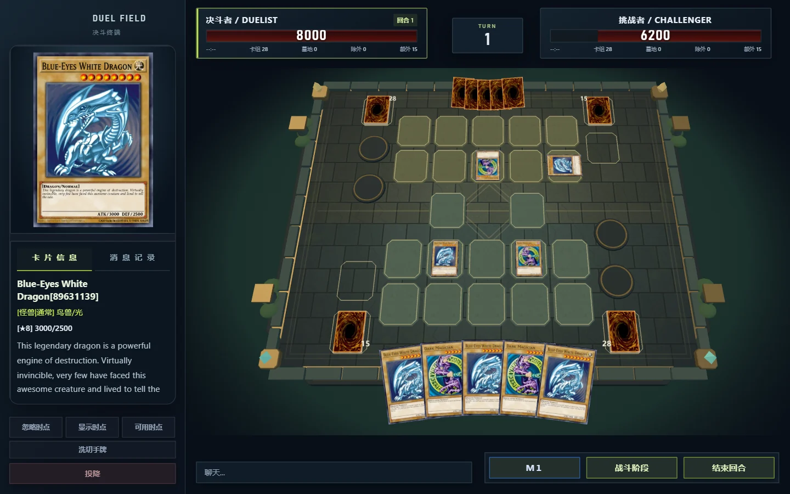
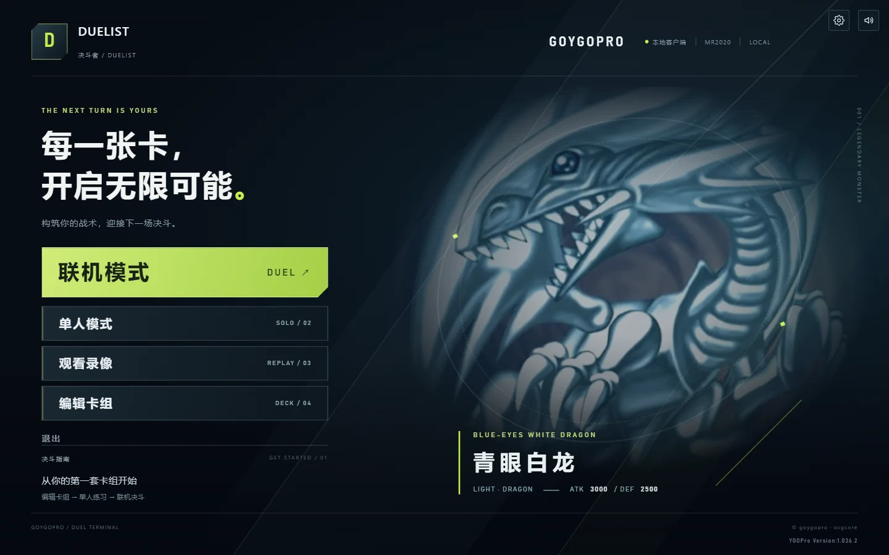
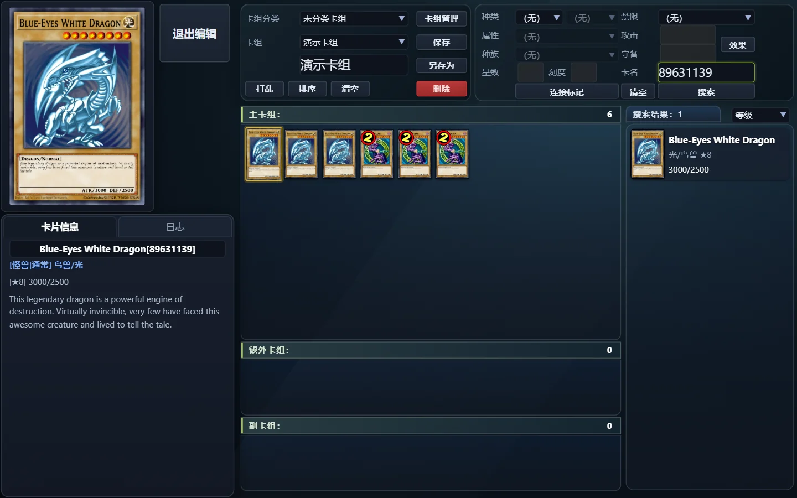
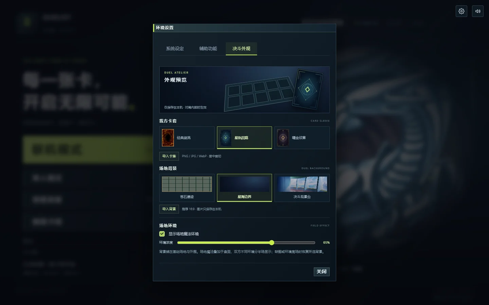

# GoYGOPro

**Go + Wails v3 + React + Three.js 的游戏王对战客户端与服务器。**

提供联机大厅、卡组编辑、单人残局与录像回放。游戏内界面参考 Master Duel 的构图，使用原创程序化石质场地、独立区域轮廓和双方扇形手牌。



*实际界面与内置演示对局。截图用于展示效果；在新电脑上运行完整桌面功能，请先完成[资源准备](docs/setup-and-troubleshooting.md)。*

## 界面展示

| 主菜单 | 卡组编辑 |
| --- | --- |
|  |  |



## 主要功能

- **联机对战**：大厅、建房、准备、观战、阶段操作与引擎询问。
- **卡组编辑**：卡片搜索、属性筛选、主卡组 / 额外 / 副卡组及卡组管理。
- **单人残局与回放**：通过 Go 桌面后端读取本地脚本、执行原生引擎并驱动同一套对局界面。
- **3D 竞技场**：石砖台座、金属镶边、独立区域、实体牌堆及自动取景。
- **双方手牌**：我方底部扇形展开、悬停抬起摆正；对方顶部紧凑卡背；多张牌自动收紧。
- **自定义外观**：图片卡套、场地背景、本机保存和场地魔法柔边叠加。

## 文档导航

| 文档 | 内容 |
| --- | --- |
| [资源准备与异机运行排查](docs/setup-and-troubleshooting.md) | 家里运行为空怎么办；卡库、Lua、卡图、单机、卡组、引擎和分发目录 |
| [前后端架构与实现思路](docs/architecture.md) | 独立架构文档，包含 Mermaid 总体架构、事件时序和渲染分层图 |
| [开发与验证](docs/development.md) | 类型检查、构建、Go 测试、浏览器冒烟及已知兼容性限制 |
| [原版对照记录](docs/cpp-parity-todo.md) | 与参考实现的差距和历史修复记录 |

## 快速运行桌面端

推荐 Windows、Go 1.25+、Node.js 20+ 和 WebView2。从仓库根目录执行：

```powershell
# 首次克隆、script/ 尚不存在时执行；需要 Python 3.9+，也可按资源文档手工 Git 获取。
python tools/fetch_scripts.py
npm --prefix frontend ci
npm --prefix frontend run build
go run ./cmd/wails
```

桌面运行还需要匹配的 `cards.cdb`、`script/`、`single/`、卡组和原生引擎；离线显示卡图需要自己的 `pics/`。**代码克隆不等于全部运行资源已齐全，单独启动 Vite 也不会运行真实单机引擎。** 具体准备步骤、只复制 exe 的分发结构，以及只读检查工具均见[资源准备文档](docs/setup-and-troubleshooting.md)。

规则脚本由 [Fluorohydride/ygopro-scripts](https://github.com/Fluorohydride/ygopro-scripts) 提供，不再存放在本仓库中。[版本清单](resources/scripts.json) 固定获取版本，`script/` 作为本机外部资源被 Git 忽略；获取工具不会覆盖已有脚本目录。

`npm run dev` 后直接在浏览器打开的是 Mock 演示模式：单机不会执行 Lua，卡片搜索也不是完整本地卡库。开发真实功能时，请使用上述桌面入口，或运行 `wails3 dev` 后操作桌面窗口。

> 本项目不是官方客户端。场地几何和布局为项目自身实现，Master Duel 仅作为视觉与交互参考。
